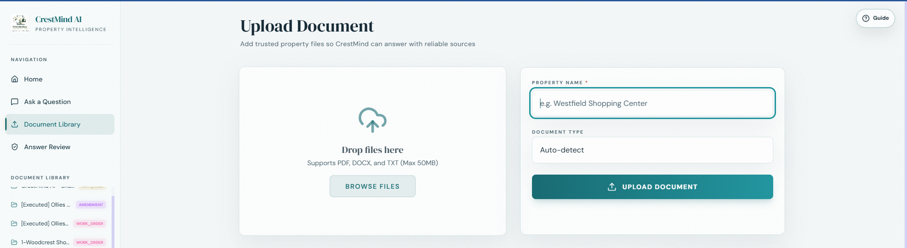
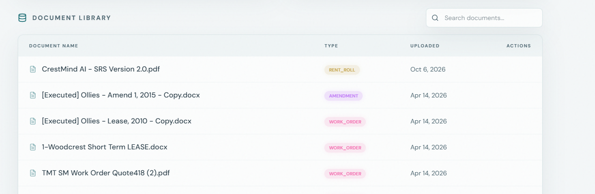
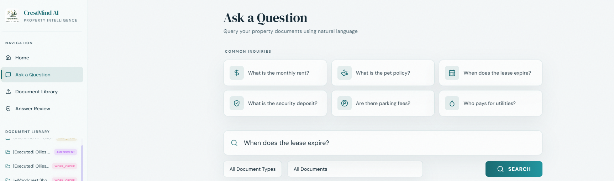
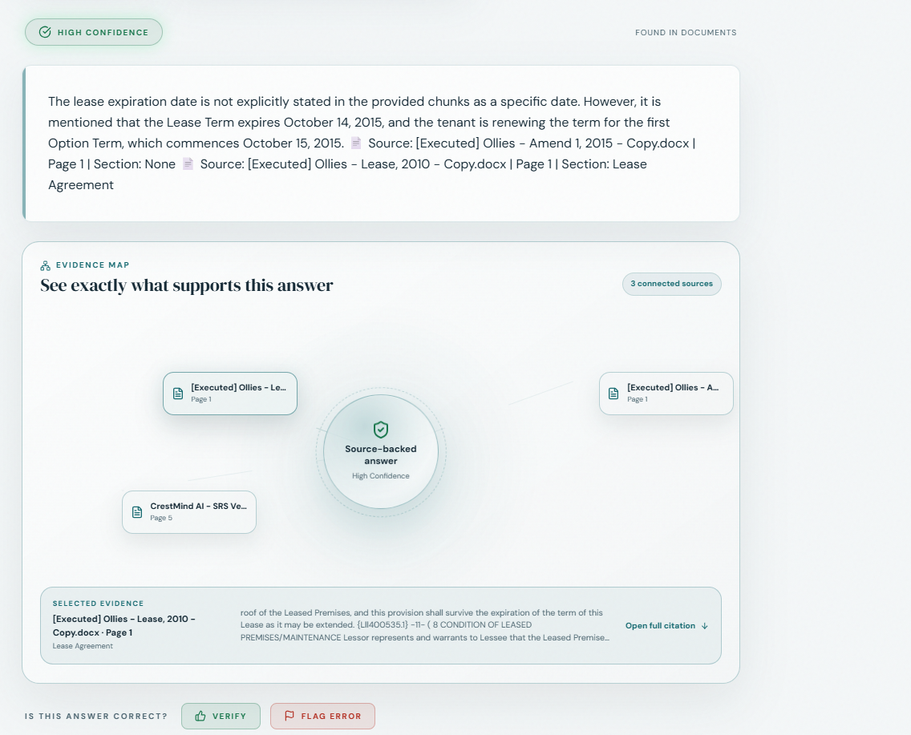
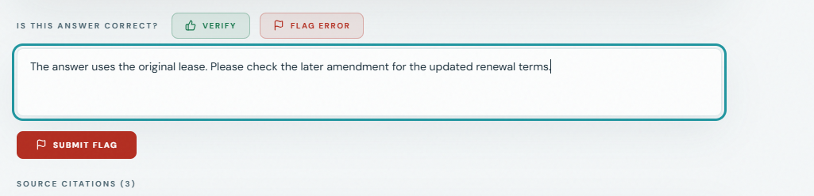
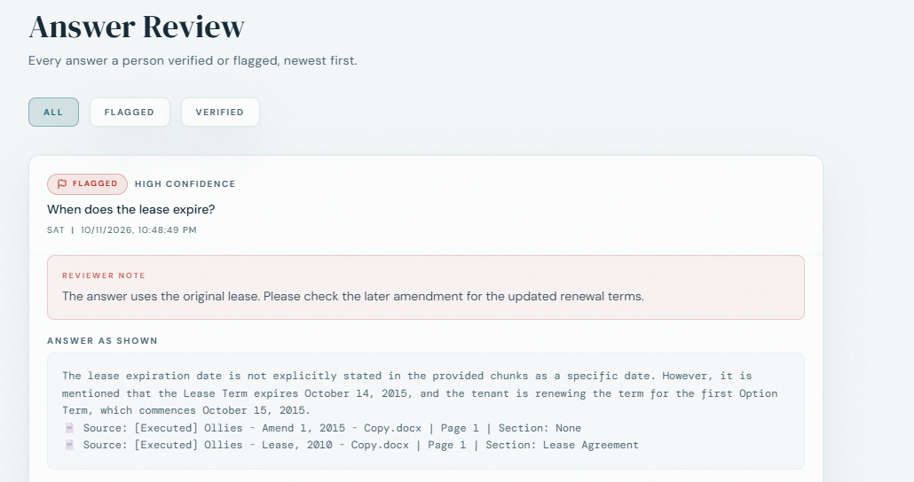

# CrestMind AI – User Manual

**Application:** AI-Powered Property Document Query System  
**Manual Version:** 1.0  
**Team Number:** 13  
**Team Name:** CapCrest – UNT Capstone  
**Date:** 10/11/2026  
**Prepared for:** Woodcrest Capital property managers  
**Team Members:** Sushil Dahal, Satish Wagle, Saurav Pandey, Smarika Koirala, and Yubraj Chaulagain

> Preparation note: The written instructions are complete. Add the six real application screenshots referenced below before submission, then remove this preparation note. The companion `screenshot-guide.md` explains exactly what to capture.

---

## 1. Introduction

CrestMind AI helps Woodcrest Capital property managers find information in leases, amendments, invoices, and other property documents by asking questions in everyday language. It shows supporting document passages so users can check where an answer came from. Users can also verify an answer or flag an error for human review, helping the team identify information that needs attention.

This manual explains the hosted capstone application. Before using an answer for a financial, legal, or tenant decision, compare it with the cited document and any relevant amendments.

---

## 2. System Requirements

- **Hardware:** A laptop or desktop computer capable of running a web browser, with an active internet connection. A larger screen makes it easier to read document passages and use filters. No special graphics card is required.
- **Operating system:** Windows or macOS with a supported browser. Smaller screens may display navigation inside a menu.
- **Software:** A current version of Google Chrome or Microsoft Edge. Allow the browser to run JavaScript and retain site data so the application can remember your session.
- **Access:** Use the application address below and the current sign-in password supplied by the project team or your designated administrator.
- **Documents:** Have an approved property file available when you want to upload it. PDF and DOCX are supported; see the upload page for its displayed file choices and size limit. Searchable text produces more useful results than an unreadable scan.
- **Other dependencies:** End users do not need to install Python, Node.js, Docker, or a database. They do not need GCP or Supabase accounts or API keys. The project team manages the hosted services.

---

## 3. Installation Guide

**No installation required—access via URL.**

1. Open Chrome or Edge.
2. Enter [https://v0-crestmind-frontend.vercel.app/](https://v0-crestmind-frontend.vercel.app/) in the address bar.
3. Confirm that the CrestMind AI property-manager sign-in page appears.
4. Bookmark the address for your next visit. You do not need to clone the GitHub repository to use the application.
5. If the page does not load, check your internet connection and follow Section 6.

The address above is the capstone application's current access link. If Woodcrest supplies a replacement address, use the address supplied by your administrator.

---

## 4. Getting Started

### Sign in and find your workspace

1. Open the application address in Section 3.
2. Enter your name or username in **Property Manager Name**.
3. Enter the password supplied by the team. Passwords are case-sensitive; do not share them in screenshots or support messages.
4. Select **Sign In as Property Manager**.
5. On **Home**, use the document-library summary and shortcuts to find your next task.
6. Open **Ask a Question** to search documents, **Document Library** to manage files, or **Answer Review** to see recorded human feedback.

The capstone sign-in uses a shared password and a user-entered name. It does not create a personal account. If you forget the password, contact the team; there is no self-service password-reset flow.

### Your first question

1. Open **Ask a Question**.
2. Enter one specific question, such as: “When does the lease expire?”
3. Select the relevant document if you know it. This is especially useful when several properties have similar leases.
4. Select **Search** and wait for the answer.
5. Read the answer and its supporting source passages. Check the document name, page, and section before relying on it.
6. After checking the source, use **Verify** or **Flag Error** as described in Section 5.3.

### Help, appearance, and signing out

- Select **Guide** at the top of the workspace for a short explanation of the main tasks.
- Use the light/dark appearance controls to choose the view that is easiest to read.
- If navigation is hidden on a smaller screen, open the menu button.
- Select **Sign Out** when finished, especially on a shared computer.

### Explore without saving changes

The sign-in page also offers **Explore Live Demo**. Demo Mode provides sample questions and prepared example answers; it does not demonstrate a fresh search of your own uploaded files. Uploads and deletion are unavailable in this mode, and demo verification or flags are not saved to the real Answer Review history. Select **Exit Demo**, then sign in normally when you need to use the live document and feedback workflows.

---

## 5. Features & Functions

### 5.1. Document Library: Add and manage property files

The Document Library holds the property information CrestMind searches. Adding the correct lease and its amendments helps users find relevant answers. Upload only files you are authorized to share with the project.

**Upload a document**

1. Sign in normally and open **Document Library**. The upload page is headed **Upload Document**.
2. Select the file area to choose a file, or drag an approved file into it.
3. Check that the selected filename is correct. Use **PDF** or **DOCX** for the documented workflow and keep the file within the limit displayed on the page.
4. Enter the **Property Name**. Use the same property name your team uses for related documents.
5. Choose the appropriate **Document Type**, such as Lease, Amendment, Invoice, Inspection, Quote, or Work Order.
6. Select **Upload Document** once. Keep the page open while processing finishes.
7. Wait for **Upload Complete**, then check that the document appears in the library. An animation alone does not confirm that the file was saved.

*Figure 1. Select an approved file and enter its property information before uploading.*

**Find or remove a document**

1. Review the document list beneath the upload area.
2. Use the library's search field to find a document by filename.
3. Check the filename, document type, and uploaded date to distinguish similar files.
4. To remove a document you are authorized to remove, locate its trash/delete control. Check the filename before selecting it: deletion starts immediately, without a confirmation dialog. Keep your original file because the application does not provide a user-facing Undo feature.
5. If you only want to search a document, use **Ask a Question** and its document filter. A library entry is not a full-document viewer.

*Figure 2. Check the document list to confirm what is available for questions.*

If an uploaded scan has no readable text, ask your administrator for a searchable copy. Do not assume that every scanned page can be read successfully.

### 5.2. Ask Questions: Read answers and check their sources

Ask Questions lets you search the available property documents using ordinary sentences. The answer, confidence label, Evidence Map, and citations help you inspect the result.

**Ask a focused question**

1. Open **Ask a Question** while signed in normally.
2. Type a question in the question field, or select a common inquiry as a starting point.
3. For a specific property or lease, choose its file under **All Documents**. Optionally choose a document type under **All Document Types**.
4. Ask one focused question at a time. For example: “What notice is required to exercise the renewal option in this lease?”
5. Select **Search** or press Enter. Wait for the final response before starting another question.

*Figure 3. Narrow your question to the relevant document when possible.*

**Check the answer**

1. Read the answer and note whether information was found in the documents.
2. Check the confidence label: **High**, **Medium**, or **Low**. The label is a signal to help review the answer; it is not a guarantee or a measured percentage of accuracy.
3. In the **Evidence Map**, select a source card to inspect the supporting passage.
4. Select **Open full citation**, or expand a card under **Source Citations**, to read the quoted passage with its document, page, and section information where available.
5. Compare important amounts, dates, addresses, and responsibilities against the original document and later amendments. The Evidence Map shows cited support; it does not replace this check.
6. If the answer is unclear, rephrase the question or select a more relevant file. If it is incorrect, follow Section 5.3.

*Figure 4. Read the supporting document passage before acting on an answer.*

**Example:** If you ask “What is the monthly rent?”, check which lease and amendment the answer cites. Do not apply an amount from one property's lease to another property.

### 5.3. Human Review: Verify, flag, and revisit an answer

Human review gives property managers a way to record whether an answer is correct or needs attention. A saved record retains the question, answer, cited sources, selected action, reviewer name, time, and any reviewer note.

**Verify a correct answer**

1. Ask a question and inspect the cited sources as described in Section 5.2.
2. Find **Is this answer correct?** below the answer/evidence area.
3. Select **Verify** only after checking the supporting information.
4. Wait for the confirmation. If an error appears, the application has not confirmed that your feedback was saved.

**Flag an incorrect answer**

1. Select **Flag Error** beneath the answer.
2. In the note field, explain what needs correction. A useful note identifies the document and page or section, the disputed statement, and what the source actually says.
3. For example, write: “The answer appears to use the original lease. Please check the renewal wording in the later amendment before confirming this date.” Use the actual source details for your case.
4. Select **Submit Flag** once and wait for **Flagged for review**.
5. If saving fails, keep a copy of your question and note so you can retry or report the problem to support.

*Figure 5. Explain the issue so a reviewer can find and check the disputed information.*

**Review recorded feedback**

1. Open **Answer Review** from navigation.
2. Select **All**, **Flagged**, or **Verified** to choose which records to display.
3. Select a record to expand it.
4. Read the reviewer note, **Answer as shown**, and **Sources cited**. Check the recorded name and time when distinguishing similar questions.
5. Use the record to support follow-up with the team. This screen displays history; it does not provide a correction-approval or resolution workflow.

*Figure 6. Revisit the answer and evidence that a person verified or flagged.*

Flagging records an issue for human follow-up. It does not automatically retrain the AI, change the source documents, or guarantee that the next answer will be different. Answer Review includes answers people verified or flagged; an answer is not automatically added just because it has medium or low confidence.

---

## 6. Troubleshooting

| Problem | Possible cause | What to do |
|---|---|---|
| The website will not load. | Internet interruption or a hosted service is unavailable. | Check another website, reload CrestMind once, and confirm the URL. If it still fails, contact support with the time and error message. |
| Sign-in fails. | A field is empty or the shared password is incorrect. | Enter your name and the current password carefully. Request the password from the team if needed; there is no password-reset button. |
| A document will not upload. | Unsupported file, file exceeds the displayed limit, unreadable file, or a service interruption. | Use an approved PDF/DOCX within the displayed limit. Check whether it already appears in the library before retrying. If necessary, request a readable/searchable copy and contact support. |
| The answer is missing or irrelevant. | The needed file is absent, filters exclude it, or the question is too broad. | Confirm the document is in the library. Clear or change filters, select the correct file, and ask a more specific question. |
| A displayed amount or date seems wrong. | The wrong document or an earlier version may have been used, or the AI misunderstood the text. | Check the original source and amendments. Select Flag Error and explain the discrepancy. Avoid using the disputed value until checked. |
| Feedback cannot be recorded. | The feedback service or its database is unavailable or misconfigured. | Keep the question, answer, and correction note. Retry later; if it persists, contact the team. Do not treat the failed submission as saved. |
| Answer Review is empty. | Demo Mode is active, no feedback has been saved, the selected filter hides records, or records could not load. | Exit Demo and sign in normally, select All, and refresh. Confirm the feedback succeeded. Contact support if a confirmed record remains missing. |
| Upload controls are absent or the question box is locked. | Demo Mode is active. | Select Exit Demo, then sign in normally to use your own files and questions. |

When requesting help, include the page name, action attempted, time, and exact error message. If you attach a screenshot, hide passwords and confidential tenant or property information.

---

## 7. Contact Information

- **Team contact:** Satish Wagle, CapCrest Team 13 — [aadesh.wagle@gmail.com](mailto:aadesh.wagle@gmail.com).
- **Application website:** [CrestMind AI](https://v0-crestmind-frontend.vercel.app/).
- **Project repository:** [Sat-ish77/Crest-Mind-AI](https://github.com/Sat-ish77/Crest-Mind-AI).
- **Woodcrest users:** Contact your designated Woodcrest administrator for approved documents, access details, and decisions requiring property-management approval.

For technical help, describe the problem using Section 6. Do not post confidential property documents, credentials, or tenant information in a public GitHub issue.

---

## 8. FAQ

**Q: Do I have to install anything or have a GCP account?**  
**A:** No. Open the application URL in your browser. The team manages the server and database.

**Q: What is the Document Library?**  
**A:** It is the collection of property files available for CrestMind to search. Check that the relevant lease and amendments are present before asking about them.

**Q: Does High Confidence mean the answer is definitely correct?**  
**A:** No. Always check the cited source before using important amounts, dates, or legal terms.

**Q: Will flagging an error immediately teach the AI the correct answer?**  
**A:** No. A flag creates a review record. The team must investigate and make any necessary changes separately.

**Q: Why is my demo feedback missing from Answer Review?**  
**A:** Demo answers and feedback are not saved to the real review history. Exit Demo and sign in normally to record real feedback.

**Q: Can I open the entire original document inside CrestMind?**  
**A:** The documented interface displays source passages and citations. Use your organization's original document copy when you need to inspect the full file.

**Q: What makes a better question?**  
**A:** Select the relevant file, ask one specific question, and name the date, clause, tenant, or amendment you mean when that detail matters.
